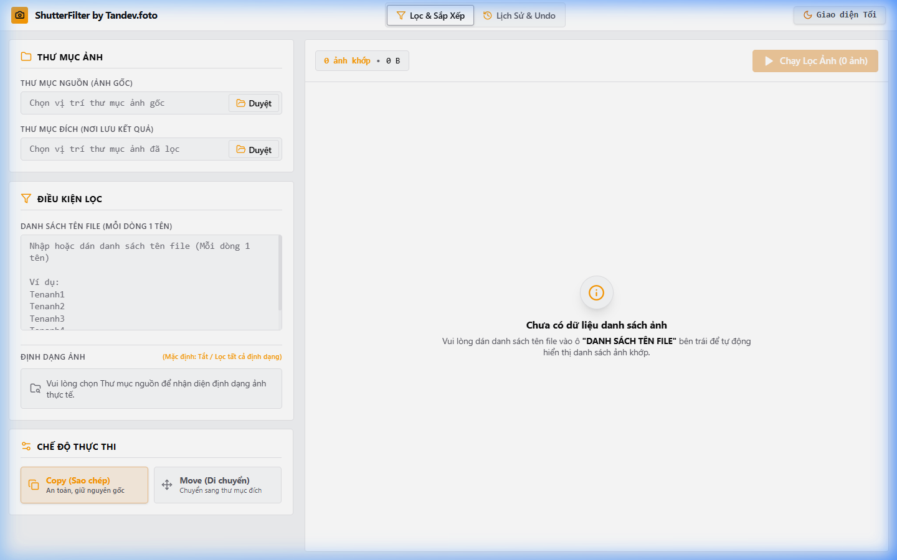
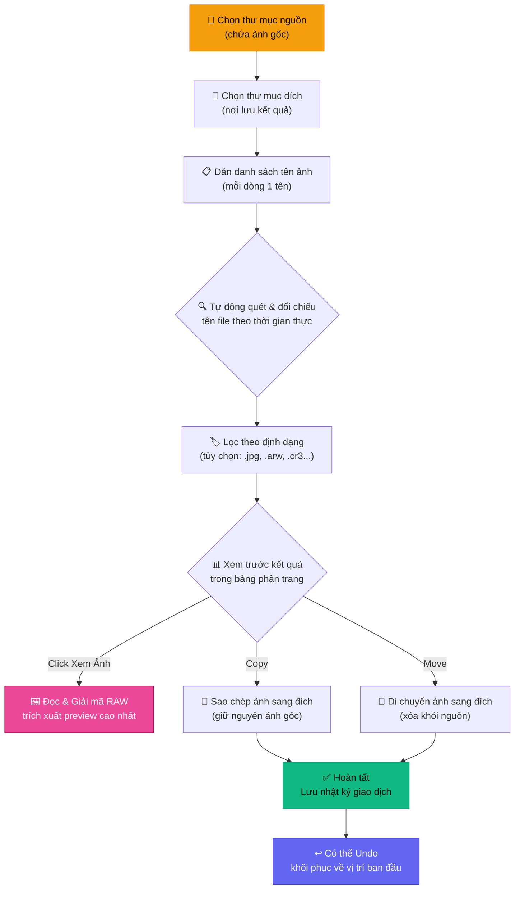
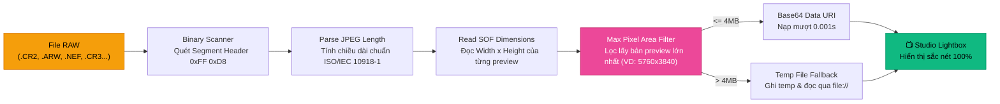
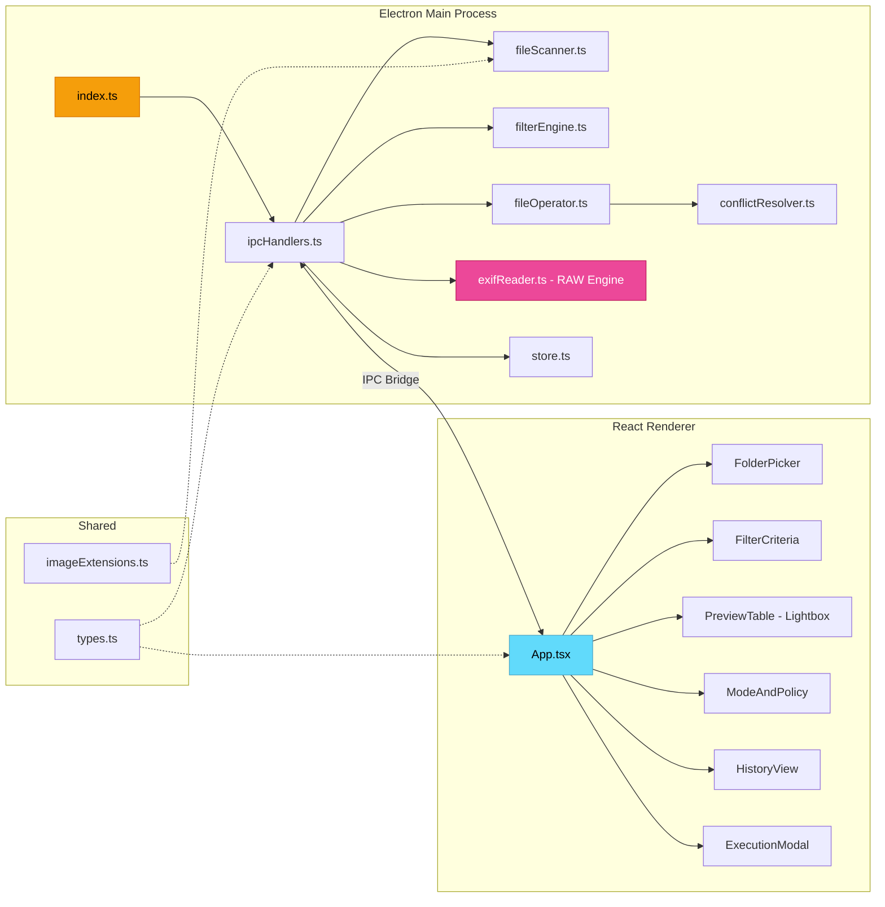
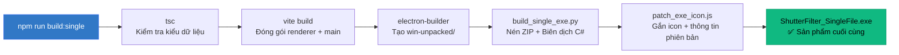

<p align="center">
  
</p>

<h1 align="center">ShutterFilter</h1>

<p align="center">
  <strong>by Tandev.foto</strong>
</p>

<p align="center">
  <a href="https://github.com/duongthaitan/ShutterFilter/releases"></a>
  
  
  
  
  
  
</p>

<br/>

<p align="center">
  Công cụ desktop lọc & phân loại ảnh hàng loạt theo danh sách tên file.<br/>
  Thiết kế tối ưu cho Nhiếp ảnh gia, Studio & Chuyên viên hậu kỳ làm việc với kho dữ liệu RAW lớn.
</p>

<br/>

<table>
<tr>
<td width="50%">

**Giao diện Tối (Studio Dark)**


</td>
<td width="50%">

**Giao diện Sáng (Studio Light)**



</td>
</tr>
</table>

---

## Vấn đề cần giải quyết

Sau mỗi buổi chụp, thư mục ảnh gốc chứa hàng nghìn file — RAW lẫn JPEG. Khách hàng gửi lại danh sách tên ảnh đã chọn. Việc tìm và tách thủ công từng file trong thư mục hàng chục GB tốn nhiều thời gian và dễ nhầm.

ShutterFilter xử lý việc này: dán danh sách tên ảnh vào, chỉ định thư mục nguồn và đích, bấm chạy.

---

## Sơ đồ luồng hoạt động



---

## Cách sử dụng

```
Bước 1    Chọn thư mục nguồn         →  nơi chứa ảnh gốc sau buổi chụp
Bước 2    Chọn thư mục đích           →  nơi lưu ảnh đã lọc
Bước 3    Dán danh sách tên ảnh       →  mỗi dòng một tên (VD: DTT00970)
Bước 4    Chọn chế độ                 →  Copy (an toàn) hoặc Move (di chuyển)
Bước 5    Bấm Chạy                    →  ảnh được lọc và chuyển sang đích
```

Kết quả khớp hiển thị trực tiếp ngay khi dán danh sách, trước khi bạn thực thi bất kỳ thao tác nào.


---

## Tính năng nổi bật

| Tính năng | Mô tả |
|:---|:---|
| **Đọc & Xem trước ảnh RAW trực tiếp** | Giải mã & trích xuất ảnh xem trước độ phân giải cao cho 13 định dạng RAW máy ảnh (`.cr2`, `.cr3`, `.arw`, `.nef`, `.dng`, `.raf`, `.orf`, `.rw2`, `.pef`, `.srw`, `.x3f`, `.erf`, `.mrw`) |
| **Thuật toán Chọn Preview Max Area** | Tự động quét phân đoạn nhị phân JPEG chuẩn ISO/IEC 10918-1 (hỗ trợ cả JPEG Progressive), chọn bản preview có diện tích pixel lớn nhất (5760x3840, 1616x1080) thay vì thumbnail EXIF 160x120 |
| **Khung xem ảnh Studio Lightbox** | Hiển thị toàn màn hình nền tối `#111114`, hỗ trợ phím tắt `←` / `→` chuyển ảnh, `Space` phóng to/thu nhỏ, `Esc` đóng và mở nhanh vị trí file trong Explorer |
| **Đối chiếu thông minh & Cảnh báo thiếu** | Hỗ trợ chế độ khớp `Chứa` / `Bắt đầu` / `Chính xác`, nút **Chuẩn hóa** danh sách (tách dấu phẩy, bỏ đuôi file, lọc trùng), chọn/bỏ từng ảnh và cảnh báo + sao chép danh sách tên ảnh chưa tìm thấy |
| **Kéo thả thư mục & Quét siêu tốc** | Kéo thả thư mục trực tiếp vào ô Nguồn/Đích, tạo nhanh `/Da_Loc`, tự động loại trừ thư mục đích nằm trong nguồn, quét song song có cache EXIF |
| **Tùy chọn nâng cao & Bộ lọc mẫu (Presets)** | Tùy chọn xử lý trùng tên (`Đổi tên` / `Bỏ qua` / `Ghi đè`), chia thư mục con (`Định dạng` / `Ngày chụp` / `Từ khóa`), di chuyển an toàn khác ổ đĩa (`EXDEV`) và lưu/áp dụng nhanh các Bộ Lọc Mẫu |
| **Loại trừ video** | `.mp4`, `.mov`, `.avi`, `.mkv` luôn bị loại khỏi kết quả |
| **Phân trang & Sắp xếp hiệu năng cao** | 50 / 100 / 250 / 500 dòng mỗi trang kèm sắp xếp theo tên, định dạng, dung lượng, ngày chụp |
| **Nhật ký & Hoàn tác (Undo)** | Ghi log nguyên tử (atomic write), lọc trạng thái file, khôi phục vị trí file ban đầu kể cả khác ổ đĩa |
| **Chuyển đổi Dark / Light Theme** | Giao diện tối/sáng đạt chuẩn tương phản WCAG AA, khởi động không nháy màn hình, hoạt động 100% offline |
| **File .exe độc lập (Portable)** | Đóng gói thành 1 file `.exe` duy nhất (~116-122 MB), chép USB/máy khác chạy ngay không cần cài đặt |

---

## Bộ giải mã ảnh RAW (RAW Preview Engine)

ShutterFilter tích hợp bộ giải mã nhị phân sâu dành cho ảnh RAW chuyên nghiệp:



---

## Định dạng ảnh hỗ trợ

```
RAW       .arw   .cr2   .cr3   .nef   .dng   .raf   .orf   .rw2   .pef
Bitmap    .jpg   .jpeg  .png   .webp  .tiff  .bmp   .heic
```

---

## Nhật ký & Hoàn tác

Mỗi thao tác copy/move tạo ra một bản ghi giao dịch. Bạn có thể xem lại lịch sử, kiểm tra file nào đã được chuyển đi đâu, và hoàn tác bất kỳ lần chạy nào để đưa file về đúng vị trí ban đầu.


---

## Sơ đồ kiến trúc hệ thống



---

## Cấu trúc mã nguồn

```
src/
├── main/                        # Electron main process
│   ├── index.ts                 # Cửa sổ ứng dụng, vòng đời app
│   ├── ipcHandlers.ts           # Cầu nối IPC giữa main và renderer
│   ├── fileScanner.ts           # Quét thư mục, nhận diện đuôi ảnh
│   ├── filterEngine.ts          # Logic đối chiếu tên file
│   ├── fileOperator.ts          # Thực thi copy/move kèm báo tiến trình
│   ├── exifReader.ts            # Bộ giải mã nhị phân ảnh RAW (Max Area JPEG)
│   ├── conflictResolver.ts      # Xử lý trùng tên file
│   └── store.ts                 # Lưu trữ nhật ký (JSON)
│
├── renderer/                    # Giao diện React
│   ├── App.tsx                  # Component gốc, state, chuyển đổi theme
│   ├── index.css                # Design tokens, biến theme
│   └── components/
│       ├── FolderPicker.tsx      # Chọn thư mục nguồn / đích
│       ├── FilterCriteria.tsx    # Nhập tên ảnh + chọn đuôi
│       ├── PreviewTable.tsx      # Bảng kết quả phân trang + Lightbox RAW xem ảnh
│       ├── ModeAndPolicy.tsx     # Chọn chế độ Copy / Move
│       ├── HistoryView.tsx       # Xem nhật ký + hoàn tác
│       └── ExecutionModal.tsx    # Thanh tiến trình + hành động sau khi xong
│
└── shared/
    ├── types.ts                 # Interface dùng chung
    └── imageExtensions.ts       # Danh sách đuôi ảnh hợp lệ
```

---

## Phát triển & Biên dịch

```bash
# Cài đặt thư viện
npm install

# Chạy chế độ dev (cửa sổ Electron, hot reload)
npm run dev

# Chạy bộ test (28 tests, unit + E2E + regression)
npm test

# Đóng gói thành 1 file .exe
# Yêu cầu: Python 3, .NET Framework 4.0 (csc.exe)
npm run build:single
# → release/ShutterFilter_SingleFile.exe
```

## Quy trình đóng gói



---

<p align="center">
  
</p>

<p align="center">
  <sub>Phát triển bởi <strong>Tandev.foto</strong> — © 2026</sub><br/>
  <sub>Công cụ nội bộ cho quy trình hậu kỳ ảnh chuyên nghiệp</sub>
</p>
