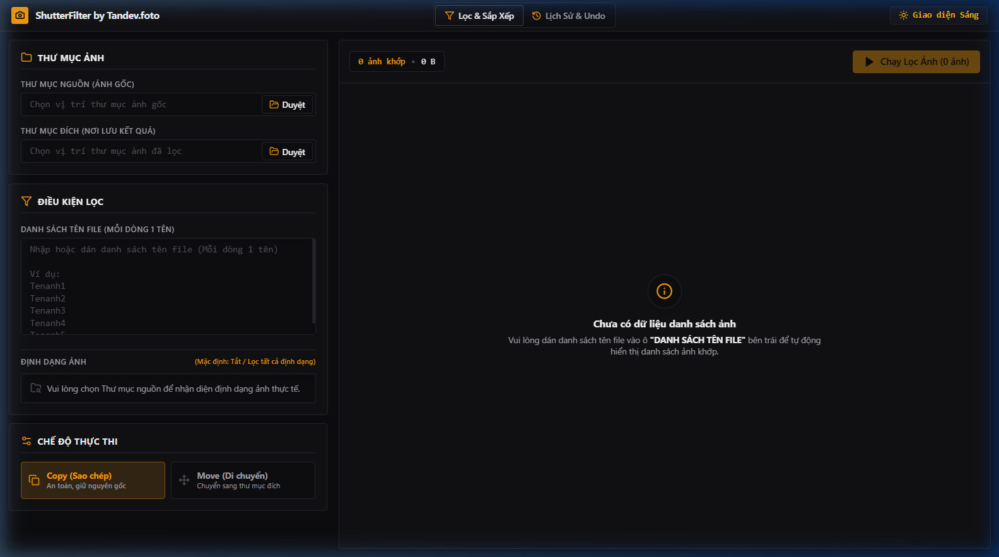
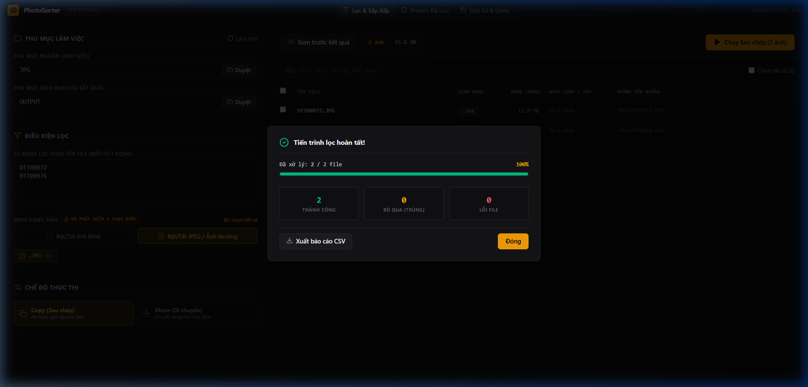

# 📸 ShutterFilter by Tandev.foto

> **Tool lọc và tách danh sách ảnh hàng loạt từ thư mục gốc dựa trên danh sách tên ảnh do khách hàng/studio chọn. Thiết kế tối ưu hiệu năng cho kho dữ liệu 10.000+ file RAW & JPEG mà không gây trễ giao diện.**

[](https://github.com/duongthaitan/ShutterFilter)
[](LICENSE)
[](https://github.com/duongthaitan/ShutterFilter)
[](https://github.com/duongthaitan/ShutterFilter)

---

## 📐 Giao Diện Trực Quan Cập Nhật Mới Nhất (Latest UI Preview)

### 1. Giao Diện Tối (Studio Dark Mode 🌙)


### 2. Giao Diện Sáng (Clean Studio Light Mode ☀️)


### 3. Xem Trước Danh Sách Ảnh Khớp Chi Tiết & Bộ Lọc Đuôi Ảnh (Chế độ Tắt Mờ `[]` Mặc Định)


### 4. Cửa Sổ Thực Thi Realtime & Tích Hợp Adobe Photoshop


### 5. Quản Lý Lịch Sử Lọc & Khôi Phục (Undo 1-Click)


---

## 🎯 Bài Toán Thực Tế (Use Case)

Trong quy trình làm việc của nhiếp ảnh gia và studio chụp ảnh chuyên nghiệp:
1. Bạn chụp một buổi làm việc tạo ra **1.000 đến 10.000+ tệp ảnh** (bao gồm cả tệp RAW như `.CR3`, `.ARW`, `.NEF` và tệp `.JPG`).
2. Khách hàng gửi lại danh sách tên các ảnh đã chọn dưới dạng văn bản (ví dụ: danh sách tên file theo dòng: `DTT00970`, `DTT00971`, `DTT00975`...).
3. Việc nhặt thủ công từng file trong thư mục gốc chứa hàng chục GB tốn rất nhiều thời gian và dễ nhầm lẫn.

**ShutterFilter** tự động quét thư mục gốc, đối chiếu danh sách tên file, lọc đúng định dạng ảnh mong muốn và copy/move sang thư mục đích chỉ trong vài giây.

---

## ⚡ Thông Số Kỹ Thuật & Hiệu Năng (Specifications & Benchmarks)

| Tiêu chí | Thông số kỹ thuật |
| --- | --- |
| **Sức chứa dữ liệu** | Đã kiểm thử tối ưu cho thư mục chứa > **10.000 file ảnh** |
| **Tốc độ phản hồi UI** | 60FPS mượt mà (Tăng tốc GPU, Phân trang 50/100/250/500 dòng) |
| **Định dạng hỗ trợ** | RAW (`.arw`, `.cr2`, `.cr3`, `.nef`, `.dng`, `.raf`, `.orf`, `.rw2`) + Bitmap (`.jpg`, `.jpeg`, `.png`, `.webp`, `.tiff`, `.bmp`) |
| **Lọc loại trừ Video** | Tự động loại bỏ tệp video (`.mp4`, `.mov`, `.avi`, `.mkv`) khỏi tiến trình |
| **Chế độ giao diện** | Chuyển đổi linh hoạt **Dark Mode 🌙** (Studio Dark) & **Light Mode ☀️** (Studio Light) ngay tại thanh Header |
| **Gói thực thi** | Single-File Executable `ShutterFilter_SingleFile.exe` (~116MB, không cần cài đặt) |

---

## 🔄 Quy Trình Xử Lý (Core Workflow)

1. **Chọn Thư Mục Nguồn & Đích**: Chỉ định vị trí chứa ảnh gốc và thư mục lưu kết quả.
2. **Dán Danh Sách Tên File**: Dán chuỗi tên ảnh (mỗi dòng một tên). Ứng dụng tự động đối chiếu theo thời gian thực.
3. **Bộ Lọc Định Dạng Tự Động**: 
   - Mặc định: Các ô định dạng ở trạng thái **Tắt/Ẩn mờ (`[]`)** ➔ Quét tất cả định dạng ảnh khớp với tên đã dán.
   - Bạn có thể bật riêng `.JPG` hoặc `.ARW` nếu chỉ muốn lọc duy nhất định dạng đó.
4. **Thực Thi Copy/Move**: Lựa chọn sao chép an toàn (giữ ảnh gốc) hoặc di chuyển ảnh sang vị trí mới.
5. **Hoàn Tác (Undo)**: Mỗi lượt chạy được lưu log giao dịch. Có thể hoàn tác trả ảnh về vị trí ban đầu bất cứ lúc nào.

---

## 🏗️ Kiến Trúc Mã Nguồn (Architecture & Build System)

```text
ShutterFilter/
├── assets/                 # Icon PE ResEdit (.ico, .png)
├── docs/images/            # Hình ảnh giao diện trực quan cho README
├── src/
│   ├── main/               # Electron Main Process (IPC, FileScanner, FileOperator, Store)
│   ├── renderer/           # React 18 + TypeScript + TailwindCSS v4 UI
│   └── shared/             # Shared Types & Image Extension Rules
├── tests/                  # Vitest Unit & End-to-End Integration Suite
├── build_single_exe.py     # Script đóng gói C# Single-File Launcher & nén Payload
└── patch_exe_icon.js       # Script ResEdit vá Icon & Version Info tệp .exe
```

---

## 🛠️ Lệnh Biên Dịch & Đóng Gói (Development & Build Commands)

### 1. Cài đặt môi trường
```bash
npm install
```

### 2. Chạy ứng dụng chế độ Dev
```bash
npm run dev
```

### 3. Kiểm thử tự động (Unit & E2E Tests)
```bash
npm test
```

### 4. Đóng gói tệp 1-File Executable duy nhất
```bash
npm run build:single
```
*Tệp `.exe` sản phẩm được xuất ra tại: `release/ShutterFilter_SingleFile.exe`*

---

## ⚖️ Giấy Phép & Tác Giả (License & Author)

- **Tác giả**: **Tandev.foto**
- **Bản quyền**: © 2026 Tandev.foto. All rights reserved.
- **Giấy phép**: MIT License
