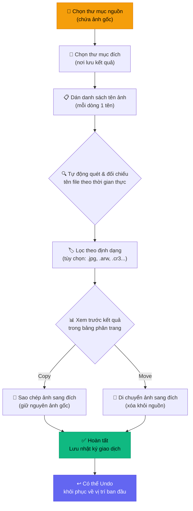
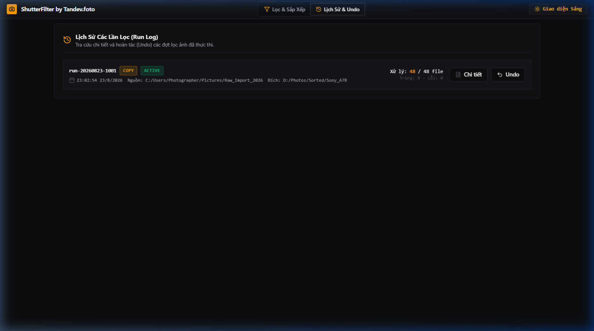
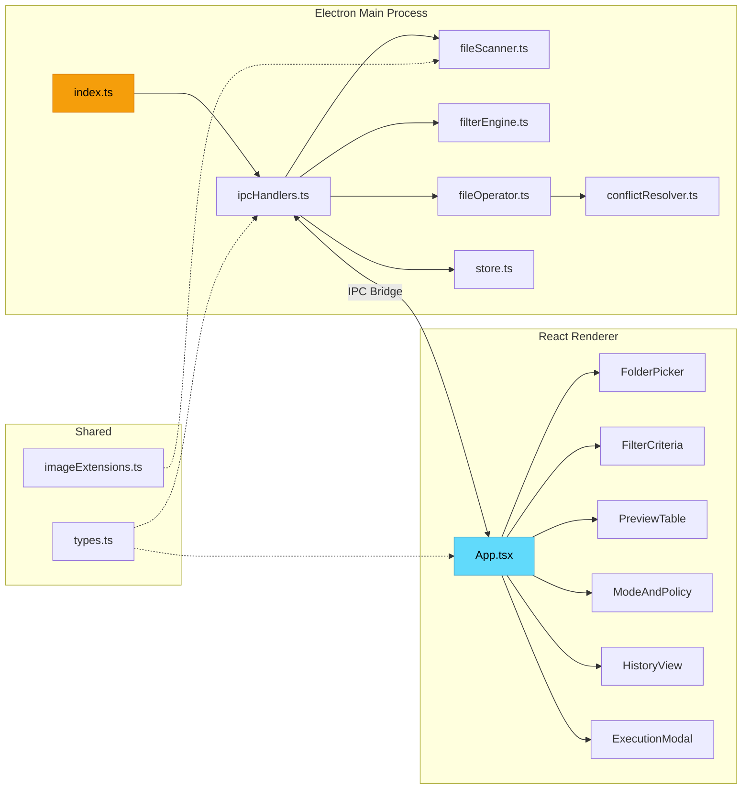
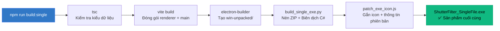

<p align="center">
  
</p>

<h1 align="center">ShutterFilter</h1>

<p align="center">
  <strong>by Tandev.foto</strong>
</p>

<p align="center">
  <a href="https://github.com/duongthaitan/ShutterFilter/releases"></a>
  
  
  
  
  
  
</p>

<br/>

<p align="center">
  Công cụ desktop lọc ảnh hàng loạt theo danh sách tên file.<br/>
  Dành cho nhiếp ảnh gia và studio cần tách nhanh ảnh đã chọn từ kho dữ liệu lớn.
</p>

<br/>

<table>
<tr>
<td width="50%">

**Giao diện Tối**


</td>
<td width="50%">

**Giao diện Sáng**


</td>
</tr>
</table>

---

## Vấn đề cần giải quyết

Sau mỗi buổi chụp, thư mục ảnh gốc chứa hàng nghìn file — RAW lẫn JPEG. Khách hàng gửi lại danh sách tên ảnh đã chọn. Việc tìm và tách thủ công từng file trong thư mục hàng chục GB tốn nhiều thời gian và dễ nhầm.

ShutterFilter xử lý việc này: dán danh sách tên ảnh vào, chỉ định thư mục nguồn và đích, bấm chạy.

---

## Sơ đồ luồng hoạt động



---

## Cách sử dụng

```
Bước 1    Chọn thư mục nguồn         →  nơi chứa ảnh gốc sau buổi chụp
Bước 2    Chọn thư mục đích           →  nơi lưu ảnh đã lọc
Bước 3    Dán danh sách tên ảnh       →  mỗi dòng một tên (VD: DTT00970)
Bước 4    Chọn chế độ                 →  Copy (an toàn) hoặc Move (di chuyển)
Bước 5    Bấm Chạy                    →  ảnh được lọc và chuyển sang đích
```

Kết quả khớp hiển thị trực tiếp ngay khi dán danh sách, trước khi bạn thực thi bất kỳ thao tác nào.


---

## Tính năng

| Tính năng | Mô tả |
|:---|:---|
| **Đối chiếu thời gian thực** | Kết quả cập nhật ngay khi dán hoặc nhập tên ảnh |
| **Nhận diện định dạng tự động** | Quét thư mục nguồn, hiển thị các đuôi ảnh tồn tại (`.jpg`, `.cr3`, `.arw`, `.nef`, `.dng`...) |
| **Bộ lọc đuôi ảnh** | Mặc định tất cả đuôi ảnh đều tắt — nghĩa là tất cả định dạng đều được bao gồm. Bật riêng nếu chỉ muốn lọc định dạng cụ thể |
| **Loại trừ video** | `.mp4`, `.mov`, `.avi`, `.mkv` luôn bị loại khỏi kết quả |
| **Phân trang** | Hiển thị 50 / 100 / 250 / 500 dòng mỗi trang cho thư mục lớn |
| **Nhật ký lọc** | Mỗi lần chạy được ghi log đầy đủ danh sách file đã xử lý |
| **Hoàn tác (Undo)** | Khôi phục file về vị trí ban đầu chỉ với một lần bấm |
| **Giao diện Sáng / Tối** | Chuyển đổi tại góc trên bên phải, tùy chọn được lưu lại |
| **File .exe độc lập** | Một file duy nhất (~116 MB), không cần cài đặt |

---

## Định dạng ảnh hỗ trợ

```
RAW       .arw   .cr2   .cr3   .nef   .dng   .raf   .orf   .rw2
Bitmap    .jpg   .jpeg  .png   .webp  .tiff  .bmp   .heic
```

---

## Nhật ký & Hoàn tác

Mỗi thao tác copy/move tạo ra một bản ghi giao dịch. Bạn có thể xem lại lịch sử, kiểm tra file nào đã được chuyển đi đâu, và hoàn tác bất kỳ lần chạy nào để đưa file về đúng vị trí ban đầu.



---

## Sơ đồ kiến trúc hệ thống



---

## Cấu trúc mã nguồn

```
src/
├── main/                        # Electron main process
│   ├── index.ts                 # Cửa sổ ứng dụng, vòng đời app
│   ├── ipcHandlers.ts           # Cầu nối IPC giữa main và renderer
│   ├── fileScanner.ts           # Quét thư mục, nhận diện đuôi ảnh
│   ├── filterEngine.ts          # Logic đối chiếu tên file
│   ├── fileOperator.ts          # Thực thi copy/move kèm báo tiến trình
│   ├── conflictResolver.ts      # Xử lý trùng tên file
│   └── store.ts                 # Lưu trữ nhật ký (JSON)
│
├── renderer/                    # Giao diện React
│   ├── App.tsx                  # Component gốc, state, chuyển đổi theme
│   ├── index.css                # Design tokens, biến theme
│   └── components/
│       ├── FolderPicker.tsx      # Chọn thư mục nguồn / đích
│       ├── FilterCriteria.tsx    # Nhập tên ảnh + chọn đuôi
│       ├── PreviewTable.tsx      # Bảng kết quả phân trang + thumbnail
│       ├── ModeAndPolicy.tsx     # Chọn chế độ Copy / Move
│       ├── HistoryView.tsx       # Xem nhật ký + hoàn tác
│       └── ExecutionModal.tsx    # Thanh tiến trình + hành động sau khi xong
│
└── shared/
    ├── types.ts                 # Interface dùng chung
    └── imageExtensions.ts       # Danh sách đuôi ảnh hợp lệ
```

---

## Phát triển & Biên dịch

```bash
# Cài đặt thư viện
npm install

# Chạy chế độ dev (cửa sổ Electron, hot reload)
npm run dev

# Chạy bộ test (17 tests, unit + E2E)
npm test

# Đóng gói thành 1 file .exe
# Yêu cầu: Python 3, .NET Framework 4.0 (csc.exe)
npm run build:single
# → release/ShutterFilter_SingleFile.exe
```

## Quy trình đóng gói



---

<p align="center">
  
</p>

<p align="center">
  <sub>Phát triển bởi <strong>Tandev.foto</strong> — © 2026</sub><br/>
  <sub>Công cụ nội bộ cho quy trình hậu kỳ ảnh chuyên nghiệp</sub>
</p>
