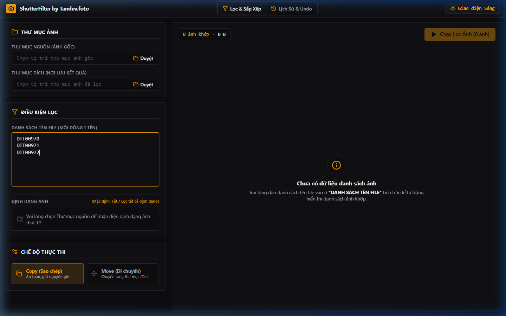

# ShutterFilter

Desktop tool for photographers and studios. Filters photos from a source folder by matching against a list of filenames, then copies or moves the matched files to a destination.

Built with Electron, React 18, TypeScript, Tailwind CSS v4.


---

## Problem

After a shoot, you have thousands of files (RAW + JPEG) in a folder. Your client sends back a list of selected photo names. Finding and extracting those files manually is slow and error-prone.

ShutterFilter automates this: paste the filename list, point to the source and destination folders, run.

---

## How it works

1. Pick a **source folder** containing your photos.
2. Pick a **destination folder** for the filtered output.
3. Paste **photo names** into the text field (one per line, e.g. `DTT00970`, `DTT00971`).
4. The app scans the source folder, matches filenames in real time, and shows results in a paginated table.
5. Optionally filter by file extension — all extensions are unchecked by default (meaning all formats are included). Toggle specific ones like `.jpg` or `.arw` if you only want certain formats.
6. Choose **Copy** (keeps originals) or **Move** (relocates files).
7. Hit run.



---

## Features

**Real-time matching** — Results update as you type or paste filenames. No manual refresh.

**Extension detection** — Scans the source folder and shows which file formats exist (`.jpg`, `.cr3`, `.arw`, `.nef`, `.dng`, etc.). Extensions default to off/unchecked so all photo formats are included unless you narrow it down.

**Video exclusion** — `.mp4`, `.mov`, `.avi`, `.mkv` and other video formats are always excluded from results.

**Pagination** — Table renders 50, 100, 250, or 500 rows per page. Handles large folders without freezing the UI.

**Run history and undo** — Every copy/move operation is logged with a full file map. One-click undo restores files to their original location.


**Dark and light themes** — Toggle between Studio Dark and Studio Light via the button in the top-right corner. Theme preference is saved to localStorage.

**Single-file executable** — Ships as one `.exe` file (~116 MB). No installer, no runtime dependencies. Drop it on any Windows machine and run.

---

## Supported formats

**RAW:** `.arw`, `.cr2`, `.cr3`, `.nef`, `.dng`, `.raf`, `.orf`, `.rw2`

**Bitmap:** `.jpg`, `.jpeg`, `.png`, `.webp`, `.tiff`, `.bmp`, `.heic`

---

## Tech stack

| Layer | Technology |
| --- | --- |
| Runtime | Electron 33 |
| Frontend | React 18, TypeScript, Tailwind CSS v4, Lucide Icons |
| Build | Vite 6, electron-builder |
| Tests | Vitest (17 tests — unit + E2E integration) |
| Packaging | C# .NET 4.0 launcher + embedded ZIP payload + ResEdit icon/version patcher |

---

## Development

```bash
# Install dependencies
npm install

# Run in dev mode (opens Electron window with hot reload)
npm run dev

# Run tests
npm test

# Build single-file .exe (requires Python 3 and .NET Framework 4.0 on the build machine)
npm run build:single
```

Output: `release/ShutterFilter_SingleFile.exe`

---

## Project structure

```
src/
├── main/               # Electron main process
│   ├── index.ts        # Window creation, app lifecycle
│   ├── ipcHandlers.ts  # IPC bridge between main and renderer
│   ├── fileScanner.ts  # Directory walking, extension detection
│   ├── filterEngine.ts # Filename matching logic
│   ├── fileOperator.ts # Copy/move execution with progress
│   ├── conflictResolver.ts  # Duplicate filename handling
│   └── store.ts        # Run history persistence (JSON)
├── renderer/           # React UI
│   ├── App.tsx         # Root component, state management, theme toggle
│   ├── index.css       # Design tokens, theme variables, component styles
│   └── components/
│       ├── FolderPicker.tsx    # Source/destination folder selection
│       ├── FilterCriteria.tsx  # Keyword input + extension toggles
│       ├── PreviewTable.tsx    # Paginated results table with thumbnails
│       ├── ModeAndPolicy.tsx   # Copy/Move mode selector
│       ├── HistoryView.tsx     # Run log browser + undo
│       └── ExecutionModal.tsx  # Progress bar + completion actions
└── shared/
    ├── types.ts              # Shared TypeScript interfaces
    └── imageExtensions.ts    # Extension whitelist/blacklist
```

---

## License

MIT — Tandev.foto, 2026
